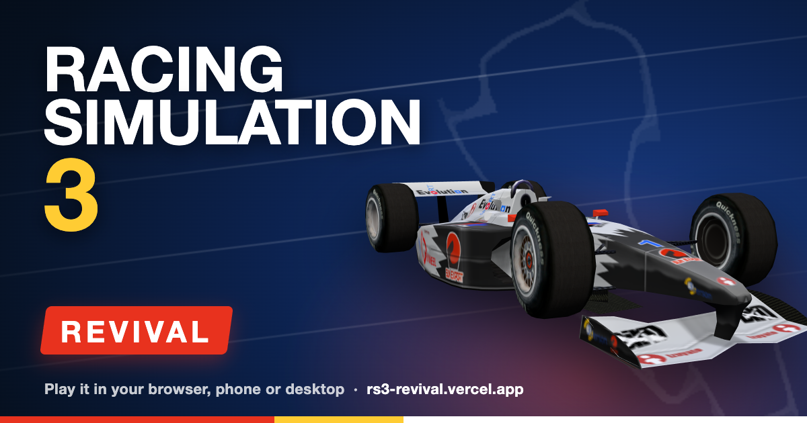
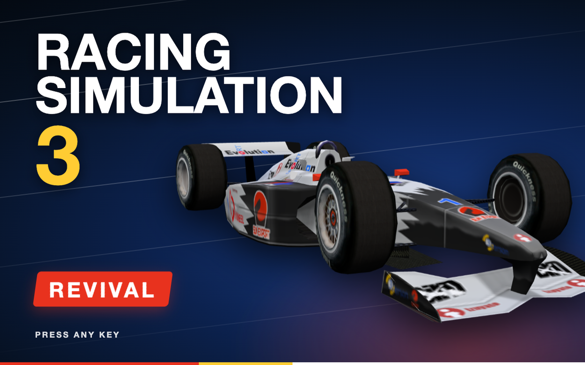
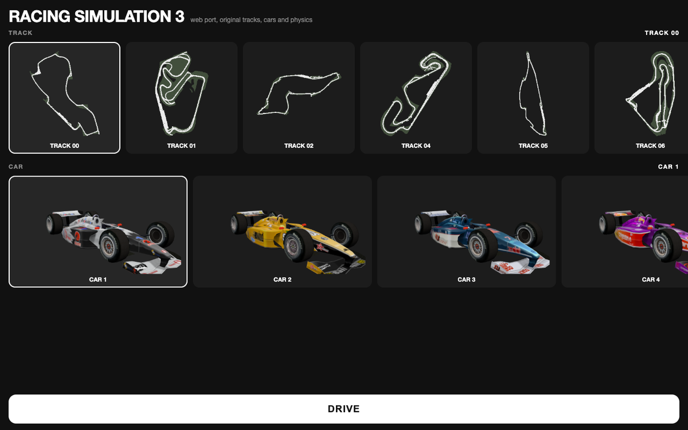
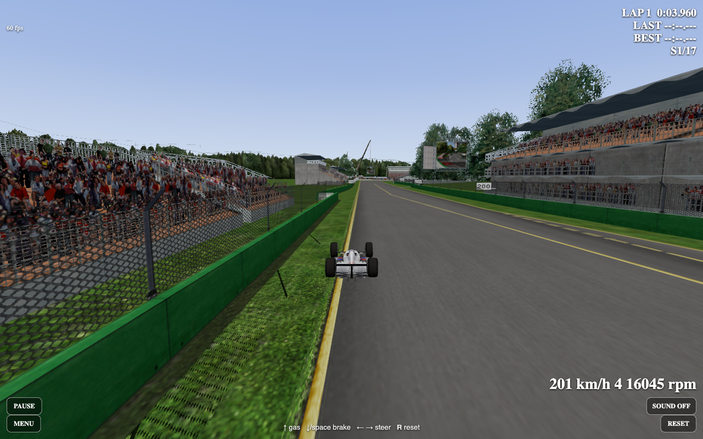
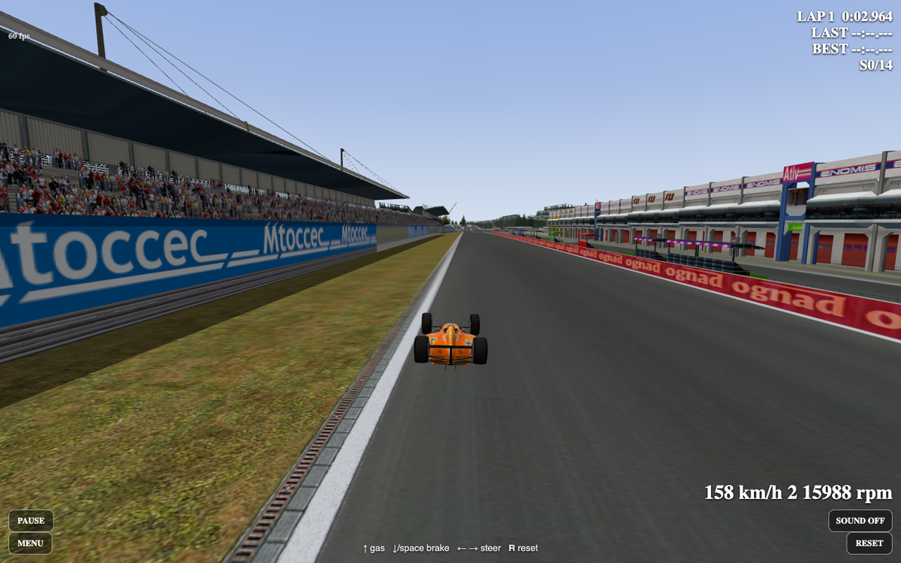
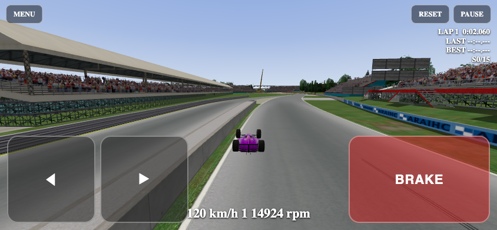
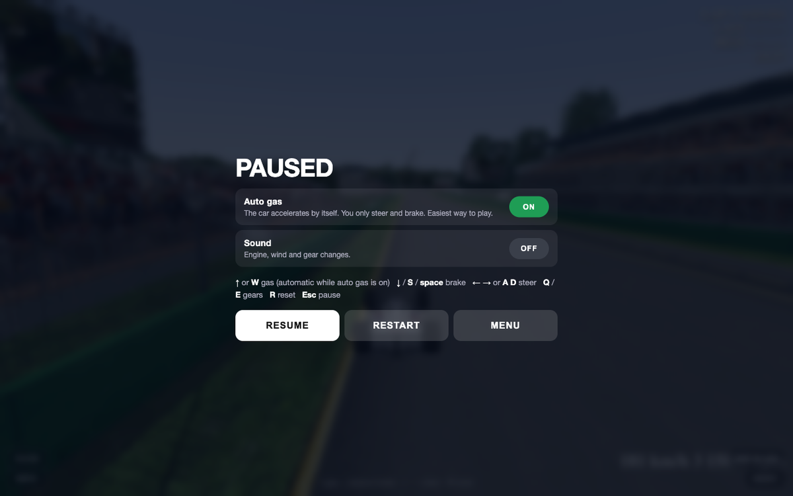
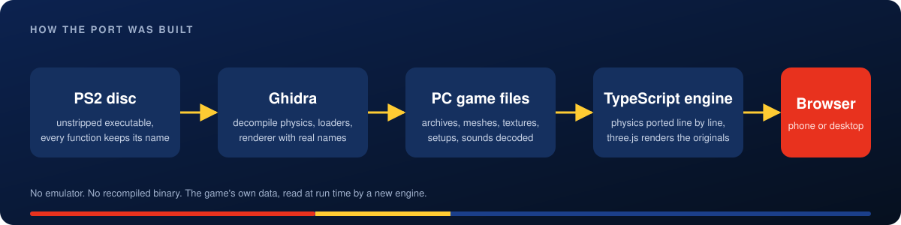
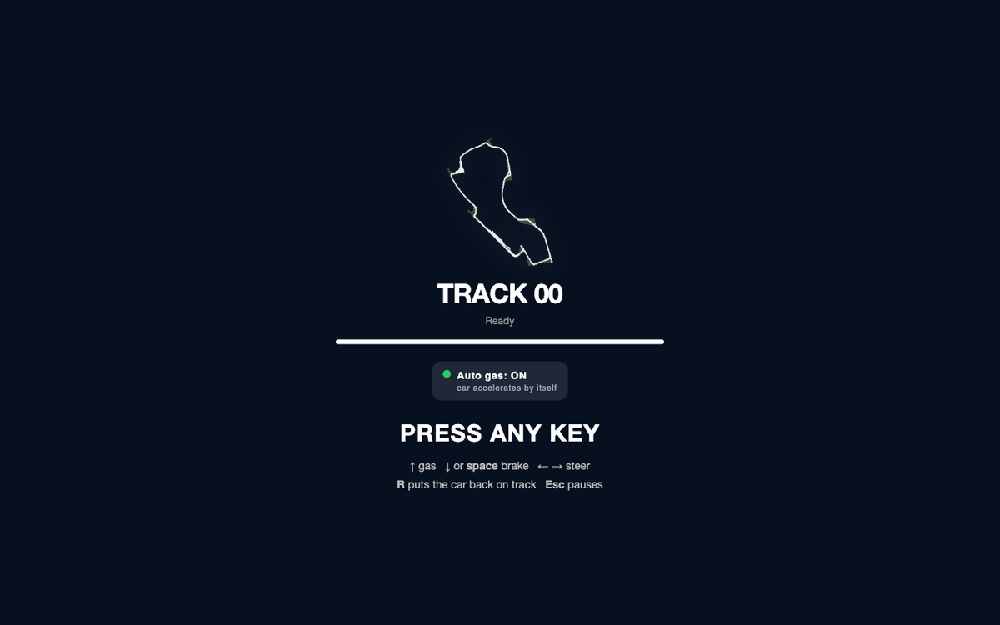

<p align="center"></p>

# Racing Simulation 3 Revival

Racing Simulation 3 is a Formula One game from 2002 (Ubisoft Paris, PC, with a PS2 version in 2003). This project brings it back as a web game that runs on a phone. The engine is rewritten in TypeScript and three.js, and it drives the original game's own tracks, cars, textures, physics data and sounds.

<p align="center"><b>Play it: <a href="https://rs3-revival.vercel.app">rs3-revival.vercel.app</a></b><br>Phone or desktop. Turn the phone sideways.</p>

It is a fan project. It is not an emulator and not a recompiled executable. Nothing from the game is in this repository (see below).

<table>
  <tr>
    <td width="50%"></td>
    <td width="50%"></td>
  </tr>
  <tr>
    <td></td>
    <td></td>
  </tr>
  <tr>
    <td></td>
    <td></td>
  </tr>
</table>

## How it was made

<p align="center"></p>

- The PS2 disc shipped its executable unstripped, so every C++ class and function kept its real name (`F1MC_F1Car::vMove`, `PART_Wheel::vComputeXYForce`, and so on).
- That binary was decompiled with Ghidra. The names made it possible to read the PC version's code and files with the right vocabulary.
- The game's data archives were decoded: `.mfd` containers, TGA textures, DCHK chunk files for render meshes (M3D), collision meshes (MMB) and the car setup variables (BSP).
- The engine was then re-implemented in TypeScript: tyres, suspension, engine, gearbox, differential and aerodynamics ported from the decompiled physics, plus the track and car renderers, lap timing and engine audio.
- The app reads the original archives straight from the game's `DataBin` folder at run time, so the tracks, liveries, textures and sounds are the real ones.

The long version, including every format that was decoded, lives in [notes/README.md](notes/README.md).

## How long it took

The whole port so far was built in one Claude Code session. It started on 22 Oct 2026 at 18:28 local time and had reached the playable state described here by 23 Oct 2026 at 09:18 local time, about 15 hours of wall-clock time. Most of that was downtime (sleep, and pauses when the Claude Max subscription's usage limit was hit).

Model: Claude Fable 5.1 in Claude Code. Measured from the session transcript: 926 assistant turns, about 1.6 million output tokens, about 4.8 million fresh input tokens, plus roughly 360 million cached-read tokens (cheap re-reads of the same context).

## Bring your own copy of the game

The game data is not included and will not be. You need your own copy of Racing Simulation 3 for PC. Once you have it installed somewhere:

```sh
git clone https://github.com/maxsorto/rs3-revival.git
cd rs3-revival

# 1. Point the app at the game's DataBin folder (symlink or copy)
ln -s "/path/to/Racing Simulation 3/DataBin" web/public/data

# 2. Decode the car setup variables out of MechaCar.mfd (193 JSON files)
python3 tools/bsp.py web/public/data/MechaCar.mfd web/public/setups

# 3. Run it
cd web
npm install
npm run dev
```

Then open the URL Vite prints. Add `--host` to try it on a phone on the same Wi-Fi.

Optional: `python3 tools/minimap.py web/public/minimaps web/public/data` re-renders the track thumbnails used by the start menu (they are already committed).

The live site exists so you can just play without any of this. If you want to change the code, fork, run locally with your copy of the game, and send a pull request.

## Controls

<p align="center"></p>

Keyboard: Up or W accelerates, Down, S or Space brakes, Left/Right or A/D steer, Q and E shift down and up, R puts the car back on the track.

Touch: left thumb steers with the two pads, right thumb brakes. Auto gas is on by default so the car accelerates by itself; turn it off in the pause menu to get a GAS pad. Tilt steering (hold the phone like a wheel) is in the pause menu too. RESET puts the car back on the track, PAUSE opens the options, MENU goes back to the start screen.

## What's done and what's next

Done:
- Full track rendering with the original meshes and textures, 16 tracks
- Car models with the original liveries, 22 cars
- Real physics port (tyres, suspension, engine, gearbox, differential, aero, wall collisions)
- Lap and sector timing
- Engine sound from the game's own sample bank
- Runs at phone size with touch controls

Next:
- AI opponents
- Tyre wear and temperature
- Damage
- Replays, menus and the rest of the game modes

## Repository layout

- `web/` the game (Vite + TypeScript + three.js). Builds to `web/dist`.
- `tools/` Python and Java scripts used to decode the archives (`mfd_ls.py`, `dchk.py`, `bsp.py`, `tex_extract.py`, `minimap.py`, Ghidra scripts).
- `scripts/` maintainer script that uploads the game archives to the storage bucket behind the live site.
- `notes/README.md` the working notes: file formats, engine map, decisions, progress.
- `DEPLOY.md` how the live site is built and where it gets its data.

## Credits, license and legal

Racing Simulation 3 was created and published by Ubisoft. "Racing Simulation 3", Ubisoft and all related names and marks are trademarks of their respective owners.

This is an unofficial, non-commercial fan project made for study and preservation. It is not affiliated with, endorsed by, sponsored by or otherwise connected to Ubisoft or anyone who worked on the original game. Nothing here claims any rights over the game.

What this repository contains is only original code written for this project (the TypeScript engine, the decoding tools and the notes). It is released under the MIT license, see [LICENSE](LICENSE). The MIT license covers only that code.

What this repository does not contain: no part of the game. No executables, no decompiled or disassembled code from the game, no models, textures, sounds, tracks, setup data or any other asset. The game's files are not distributed here and are not included in any release. To run the project yourself you need your own legitimately obtained copy of the game, which the project reads at run time and never redistributes. Users are responsible for complying with the game's license and the laws that apply to them.

The playable site exists so that people can see the result without any setup. It makes no money, has no ads and does not sell anything.

Takedown: if you are a rights holder and believe anything here or on the playable site should not be available, open an issue on this repository or contact the maintainer through GitHub and it will be taken down promptly. No argument, no delay.
